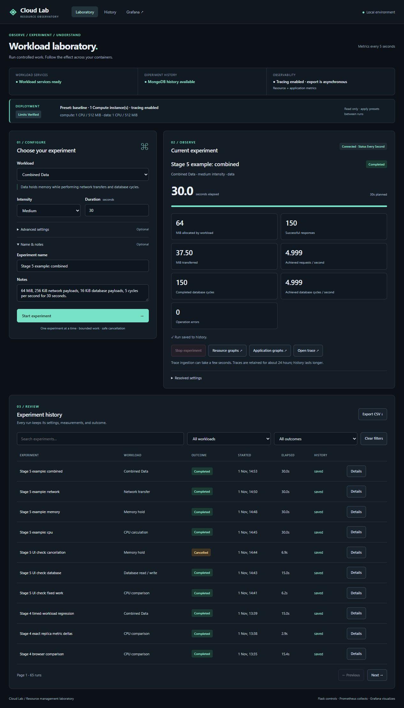
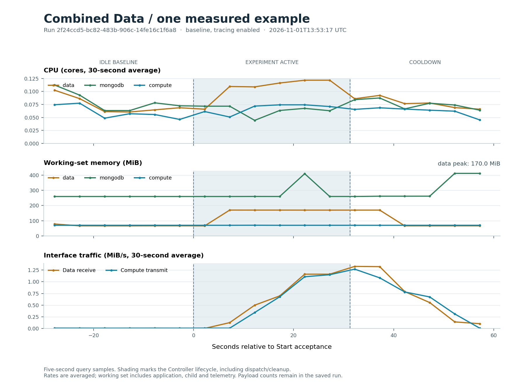
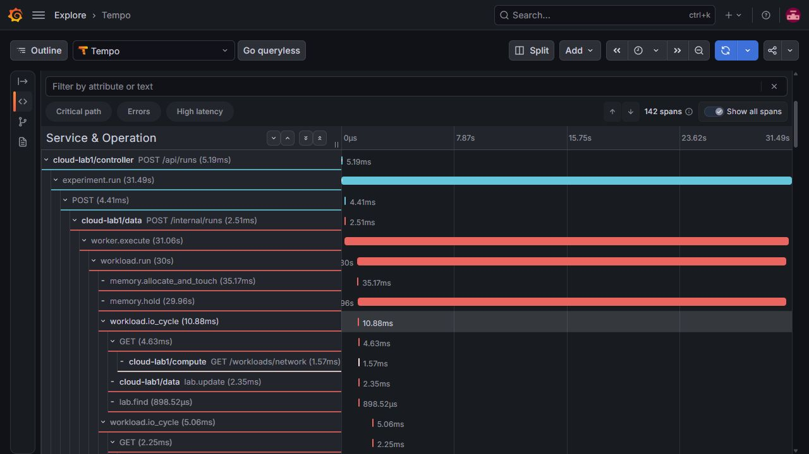

# Classroom demo: operate Cloud Lab in about 10 minutes

Use this as an operator's cue sheet. The application creates real work; Grafana shows the resulting measurements. Prepare startup before the timed walkthrough. The [repository guide](repository-guide.md) explains the implementation, and the [example results](experiment-results.md) provide saved observations to discuss.

## Before class

- Connect the laptop to power and leave room for Docker Desktop. Avoid running other heavy tasks during the demonstration.
- Open Docker Desktop and confirm its Linux engine is running.
- In PowerShell 7, change to the repository root. Build while internet is available:

```powershell
./scripts/start.ps1 -Preset baseline -Tracing
./scripts/verify.ps1
```

- For the classroom, use already prepared images:

```powershell
./scripts/start.ps1 -Preset baseline -Tracing -NoBuild
./scripts/verify.ps1
```

- Confirm **Limits verified**, **baseline**, one Compute instance, tracing enabled and nine running containers. No experiment should be active or waiting to save.
- Read your local `.env` privately and sign into Grafana before sharing the screen. Keep that file and its password out of the presentation.
- Open these views in browser tabs:

| View | Address / use |
|---|---|
| Laboratory | `http://localhost:5000` — controls, progress and history |
| Container Resources | `http://localhost:3000/d/cloud-lab1-resources` — CPU, working-set memory and interface traffic |
| Application Performance | `http://localhost:3000/d/cloud-lab1-application` — requests, operations, elapsed work and outcomes |
| Trace | Open from a new Combined run's **Open trace** link |

You can use the native browser zoom to make text readable for the room. Keep the Grafana refresh at five seconds. Use the run's graph links to select the services/time range rather than searching for old runs in a rolling window.

## Ten-minute running order

Each workload block allows roughly 30 seconds of idle baseline, 30 seconds of work, and 30 seconds of cooldown. Explain what the audience is seeing during those intervals.

| Time | What you do | What you say / show |
|---|---|---|
| 0:00–1:00 | Show the application and verified deployment; briefly show the architecture diagram | “Flask controls experiments, cAdvisor measures containers, Prometheus stores measurements, Grafana displays them. This runs locally in Linux containers.” |
| 1:00–2:30 | CPU example below | Explain CPU cores, input intensity and delayed rate graphs |
| 2:30–4:00 | Memory example | Explain requested buffer versus total working set, then show release |
| 4:00–5:30 | Network example | Show Data receive and Compute transmit; compare requested and achieved rate |
| 5:30–7:00 | Combined example | Show memory and actual network/database operation counts |
| 7:00–8:30 | Open application graphs and the Combined trace | Separate the short Start request from background execution; follow Data's HTTP and MongoDB calls |
| 8:30–10:00 | Open Details, history and CSV; answer one or two questions | Show saved settings, verified deployment, outcome and reproducibility; finish with monitoring limitations |

The basic configuration is identical for the four main examples: **baseline deployment, tracing enabled, Medium intensity, 30 seconds**. Allow the current run to complete before starting another.

## 1. CPU calculation

**Click:** Laboratory → Workload **CPU calculation** → Medium → Duration **30**. Optionally expand **Name & notes** and enter `Classroom: CPU`. Click **Start experiment**.

**Look:** The current experiment changes from Starting to Running. Calculation batches increase. Open **Resource graphs**, select **compute** if necessary, and look at **CPU usage · cores** under **CONTAINER ACTIVITY**.

**Explain:** “Medium requests 50% busy time from one calculation process. Usage is measured in cores, so approximately half a core is a useful expectation, not a guaranteed exact number. The application, tracing and scheduler also consume CPU.”

**Wait:** Rate graphs can need 10–30 seconds to show the change. Let the run finish and use the cooldown to show CPU trending back down. The **Recent CPU cores · last collection interval** panel is in **COMPUTE COMPARISONS** if a faster view is useful; it is a different sampling view from the 30-second average.

**If it looks flat:** Check `compute`, the time range and refresh. Check that the operation counter increased. Do not raise the work intensity repeatedly while another run is active.

## 2. Memory hold

**Click:** Return to the application → **Memory hold** → Medium → **30** → Start.

**Look:** The current result reports **64 MiB allocated by workload**. Open Resource graphs for **data**, then **Memory working set · MiB**. After completion, watch the working set decline as the child process exits.

**Explain:** “The buffer is 64 MiB, but this graph includes the service, Python child and telemetry. The container has a 512 MiB ceiling; a ceiling is not a request to allocate all of it.”

**Wait:** Keep the graph visible through at least one or two scrapes after completion. Use the remaining cooldown to explain the difference between usage and a limit.

**If memory remains slightly above the earlier baseline:** Check that the run completed and is no longer active. Caches and normal service activity can vary; do not promise an identical baseline byte count. Stop remains available for active work.

## 3. Network transfer

**Click:** **Network transfer** → Medium → **30** → Start. Advanced settings should resolve to **256 KiB** and **5 requests / second**.

**Look:** The application shows successful responses, MiB transferred and achieved requests per second. Its resource link initially selects Data. In Grafana's **Service** selector, add **compute** while retaining **data**. Compare:

- **Network receive · bytes/s:** the Data series should show the downloads.
- **Network transmit · bytes/s:** the Compute series should show the payload responses.

**Explain:** “Data is the HTTP client. Compute sends the payload; Data receives and discards it. The requested payload rate is 1.25 MiB/s. The achieved rate is measured, and interface traffic includes protocol/control traffic.”

**Wait:** Let the run complete, then watch the averaged traffic rate settle during cooldown. A five-second refresh does not make a 30-second rate instantaneous.

**If the wrong graph rises:** Check which service and traffic direction you selected. Do not describe Data's receive traffic as browser downloads.

## 4. Combined Data and its trace

**Click:** **Combined Data** → Medium → **30** → Start. Advanced settings show **64 MiB**, **256 KiB** network payloads, **16 KiB** database payloads and **5 cycles / second**.

**Look:** The application shows memory, network responses/bytes and completed database cycles. The resource link selects **data + mongodb**. Add Compute when explaining payload transmission.

**Explain:** “One background action holds memory, downloads payloads and performs a database write/read cycle. Temporary workload documents are cleaned up; the experiment summary stays in history.”

After completion, open **Application graphs**. Under **WORKLOAD ACTIVITY**, find **Actual workload operation rate** and **Data payload throughput**. Under **HTTP PERFORMANCE**, explain that the Start request is short because the work continues outside the request. HTTP polling traffic has its own route labels.

Open **Open trace** from the same run. Allow a few seconds for ingestion, then locate:

1. Controller's `POST /api/runs` and the longer `experiment.run` span.
2. Data's `POST /internal/runs`, `worker.execute` and `workload.run` spans.
3. Memory allocation/hold and representative `workload.io_cycle` spans.
4. Compute's payload request and MongoDB client calls such as `lab.update` and `lab.find`.

Use **Collapse all**, then expand the relevant branches if the trace is too long. Explain: “A trace links phases of one experiment. Successful I/O details are sampled for readability; operation metrics still count all reported work. MongoDB client spans describe driver calls, not MongoDB's internal execution plan.”

Trace colours identify services and are separate from error status. Use the **Errors** filter and span status to discuss failures; a red service colour alone does not mean failure.

**If the trace is missing:** Confirm tracing is enabled, retry after ingestion, and check that the record is recent. Traces expire independently of history. Use the saved trace screenshot below if needed and explicitly identify it as saved evidence.

## 5. Close with history and export

In **Experiment history**, search for `Classroom:` or the name you used. Open **Details**. Show the resolved settings, saved deployment table, timing, actual operation counts and error/outcome fields. CPU comparison records additionally show per-instance and batch results.

Click **Export CSV**. Explain that the active history filters also apply to export. Demonstrate **Clear filters** afterward. Saved history and the monitoring volumes survive normal stop/start.

Suggested closing sentence: “We can create bounded activity, connect it to real container measurements, and keep enough settings and evidence to explain the result. These four examples demonstrate behaviour; they are not a formal repeated benchmark.”

## Optional extension: CPU allocation, about 4–6 extra minutes

Only change a preset when no experiment is active.

1. Apply `cpu-05`, verify the read-only deployment card, then select **CPU comparison**, Medium: **32 batches**, two calculation processes total, 180-second safety deadline. Start and save the run.
2. Apply `cpu-2`, verify its effective ceiling, and repeat exactly the same work.
3. Compare saved elapsed times and CPU graphs. In **ALLOCATION & THROTTLING**, explain quota-relative utilization and throttled periods separately. Show that both completed 80,000 units with checksum **12,007,132,800,000**.

```powershell
./scripts/apply-preset.ps1 -Preset cpu-05
# Run CPU comparison and wait for completion.
./scripts/apply-preset.ps1 -Preset cpu-2
# Run the same CPU comparison and wait for completion.
./scripts/start.ps1 -Preset baseline -Tracing -NoBuild
```

The smaller allocation can take substantially longer. Do not promise a specific speedup. If time is short, use the clearly labelled [saved Stage 4 comparison](stage-4.md) and explain that it was measured earlier.

## Optional extension: one versus two Compute instances, about 4 extra minutes

1. Apply `replica-1`. Run CPU comparison, Medium, **32 batches**. One container uses two slots.
2. Apply `replica-2`. Verify both instances, then repeat the same 32 batches. Each instance now has one slot.
3. Open Details and show **16 completed batches / 40,000 units per instance**. In resource graphs, select **compute + compute-2** and inspect the individual and **Aggregate Compute CPU** panels. In application graphs, show **Aggregate Compute calculation throughput**.
4. Explain that the second container increases total Compute allocation from 1 CPU/512 MiB to 2 CPUs/1,024 MiB. Total work and calculation concurrency remain constant, but this does not isolate scaling efficiency at equal resources.
5. Restore baseline with tracing enabled.

```powershell
./scripts/apply-preset.ps1 -Preset replica-1
# Run fixed work and wait.
./scripts/apply-preset.ps1 -Preset replica-2
# Run identical fixed work and wait.
./scripts/start.ps1 -Preset baseline -Tracing -NoBuild
```

## Recovery card

| Symptom | What to do |
|---|---|
| Start unavailable | Read service/maintenance status and check for an active run. Wait for reconciliation; do not start another deployment during work. |
| Preset change rejected | Finish or Stop the active experiment, then apply the preset again. |
| Deployment remains in maintenance/error | Run the baseline recovery startup command below and verify before continuing. |
| No resource data | Confirm Service and time range; wait for fresh samples; check Prometheus Targets and cAdvisor logs. Exporter health alone does not prove per-container measurements. |
| MongoDB unavailable | Use CPU/Memory/Network, explain pending history, and recover MongoDB before Combined/Database. Avoid restarting Controller while unsaved summaries remain. |
| Trace unavailable | Check enabled tracing, allow ingestion, or use a new Combined run. Use saved evidence honestly if Collector/Tempo is unavailable. |
| Need to stop work | Click **Stop experiment**, wait for Cancelled/Interrupted, and check that the active slot is clear. Known partial results are retained. |
| Browser disconnected | Restore the service and refresh. Browser closure does not cancel server-owned work. |

```powershell
./scripts/start.ps1 -Preset baseline -Tracing -NoBuild
./scripts/verify.ps1
docker compose logs --tail 60 controller data compute cadvisor
# After the demonstration:
./scripts/stop.ps1
```

If an image must be rebuilt, do so during preparation with the normal build/start command. Do not run the destructive reset command during the demonstration.

## Clearly labelled saved fallback views

These are saved measurements from Stage 5, not a live display. Their run IDs and exact settings are in the [results report](experiment-results.md).






