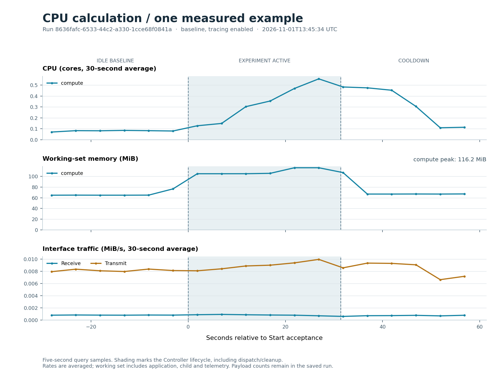
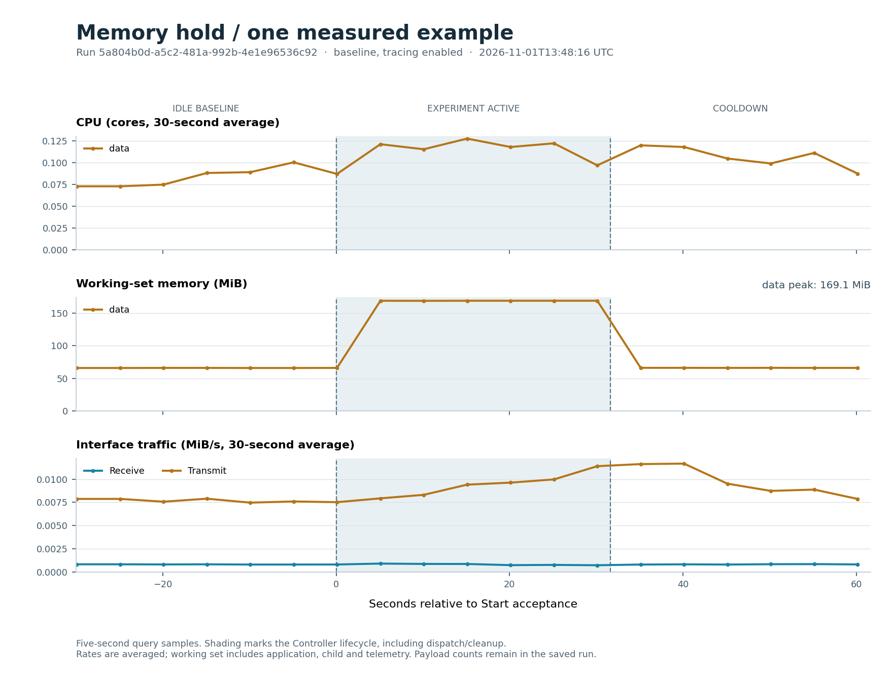
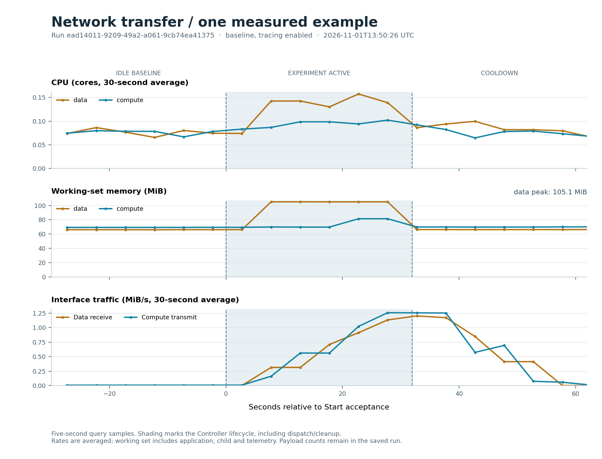
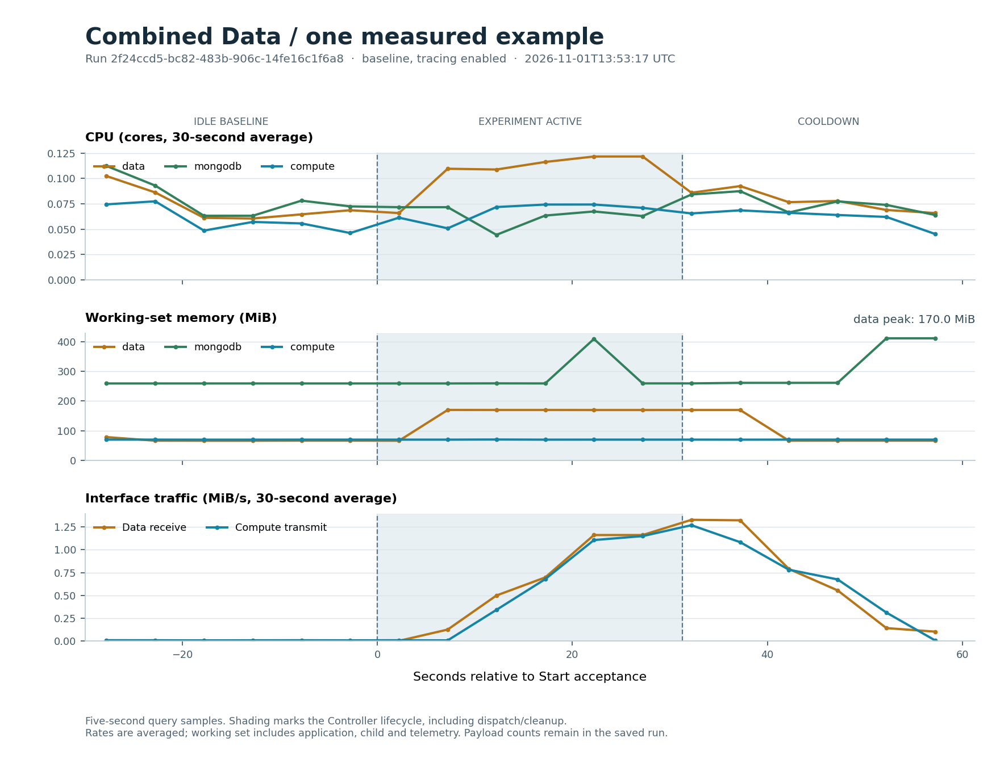
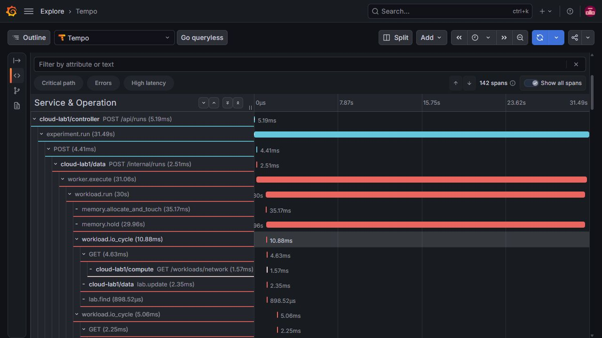

# Four examples: what we measured

These are four single-run demonstrations on the local Docker Desktop laboratory, recorded on **1 November 2026**. They show observable behaviour, rather than a repeated benchmark or a promised performance improvement.

## Setup and method

All runs used the verified **baseline** deployment with tracing enabled: Compute and Data each had one CPU and 512 MiB memory ceilings. All nine application/monitoring images stayed unchanged. Runs used Medium intensity and 30 seconds of work, one at a time.

Each run had at least 30 seconds of idle observation and 30 seconds of cooldown. Manual preparation sometimes extended the idle period; exact windows are saved. The plots show the last 30 seconds before Start, the experiment lifecycle, and cooldown. Prometheus query samples are five seconds apart. CPU and interface rates use the existing **30-second averages**.

## Actual work

| Example | Resolved inputs | Work elapsed | Reported work / achieved rate | Errors |
|---|---|---:|---|---:|
| CPU calculation | 50% busy time | 30.000 s | 44,953 calculation batches; 1,498.4/s | 0 |
| Memory hold | 64 MiB | 30.003 s | 64 MiB allocated; 16,384 pages touched | 0 |
| Network transfer | 256 KiB at 5 requests/s | 30.000 s | 150 responses, 37.50 MiB; 5.000 requests/s | 0 |
| Combined Data | 64 MiB; 256 KiB network; 16 KiB DB; 5 cycles/s | 30.005 s | 150 responses, 150 DB cycles; 4.999 requests/s and 4.999 cycles/s | 0 |

A database cycle contains one successful write and one read. Network bytes above are payload bytes actually received by Data. Exact counters come from the saved run, not from counting graph peaks. The timed CPU counter counts individual calculation-loop batches; these are different from the 2,500-unit logical batches in CPU comparison.

## Resource observations

Peaks below are sampled within each saved baseline/work/cooldown window; CPU peaks are 30-second averages. Memory values are baseline median → sampled peak → final cooldown median.

| Example / main service | Peak CPU cores | Working set (MiB) | Peak receive / transmit (MiB/s) |
|---|---:|---|---:|
| CPU calculation / compute | 0.558 | 64.9 → 116.2 → 67.1 | 0.001 / 0.010 |
| Memory hold / data | 0.127 | 65.8 → 169.1 → 66.0 | 0.001 / 0.012 |
| Network transfer / data | 0.157 | 66.1 → 105.1 → 66.2 | 1.202 / 0.015 |
| Combined Data / data | 0.122 | 66.3 → 170.0 → 66.4 | 1.328 / 0.099 |

## CPU calculation

Run `8636fafc-6533-44c2-a330-1cce68f0841a` · [saved result](evidence/stage5/cpu/run.json) · [CSV](evidence/stage5/cpu/export.csv)

Compute reached a sampled 30-second-average peak of **0.558 cores** while completing 44,953 batches. Medium controls the busy/idle input; service and telemetry overhead are included in the resource graph. The cooldown makes the end of the activity visible.

## Memory hold

Run `5a804b0d-a5c2-481a-992b-4e1e96536c92` · [saved result](evidence/stage5/memory/run.json) · [CSV](evidence/stage5/memory/export.csv)

Data's working set rose from about **65.8 MiB to 169.1 MiB**, then reached about 66.0 MiB in cooldown. The increase is larger than the 64 MiB buffer because a Python child and its libraries/telemetry also run. The buffer was released when that child exited.

## Network transfer

Run `ead14011-9209-49a2-a061-9cb74ea41375` · [saved result](evidence/stage5/network/run.json) · [CSV](evidence/stage5/network/export.csv)

Data received **150 successful responses / 37.50 MiB**. The paired lines show Data receiving payloads and Compute transmitting them. Interface traffic includes protocol/control traffic, so it should not be equated exactly with the payload counter.

## Combined Data

Run `2f24ccd5-bc82-483b-906c-14fe16c1f6a8` · [saved result](evidence/stage5/combined/run.json) · [CSV](evidence/stage5/combined/export.csv)

The same run held **64 MiB**, received **150 payload responses**, and completed **150 database cycles** (150 writes and 150 reads). The measured activity spans Data, Compute and MongoDB. Temporary workload documents were removed afterward; the run summary remains saved.

## Connected trace

The Combined trace `1cdbe47bc835d1cd81c501ee55095ca0` has **142 recorded spans** connected across Controller, Data and Compute, including MongoDB client calls. The short Start request is distinct from the longer background experiment. Selected successful I/O cycles keep the trace readable; all reported operations contribute to metrics.

## What these examples establish

All four runs completed, saved their results, reported zero operation errors, and left no active workload processes or temporary workload documents. The application images and tracing mode stayed constant. CPU, memory and network changes can be connected to the settings and actual work.

These are synthetic examples on one laptop with one execution per scenario. Five-second sampling can miss short peaks; 30-second and two-minute dashboard windows smooth activity and can include preceding work. Working set and container traffic include overhead. No CPU-allocation speedup, scaling efficiency, or statistical conclusion is established by this set.

## Reproduce or inspect

[All run records, configuration, checks and image IDs](evidence/stage5/experiments.json) · [four-run CSV](evidence/stage5/experiment-history.csv) · [query responses and evidence index](evidence/stage5/README.md). Each scenario folder also contains its exact Prometheus queries/responses and standalone SVG plot.

Use the [demo guide](demo-guide.md) to repeat the examples manually, or the evidence collector described in the evidence index. The illustrated [Albanian project report](Raporti_Projektit_Monitorimi_i_Burimeve_Plote.docx) documents the implementation and results. A formal repeated study and presentation slides remain future work.
