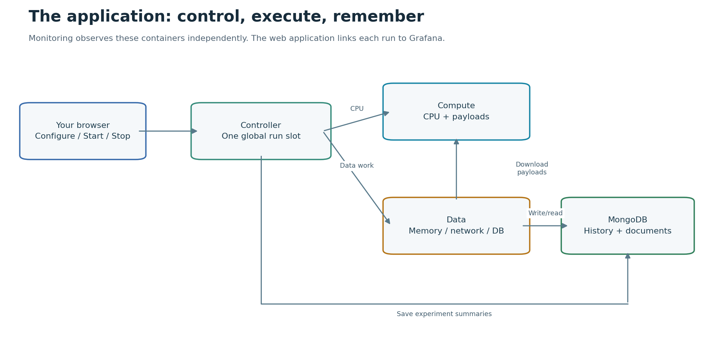
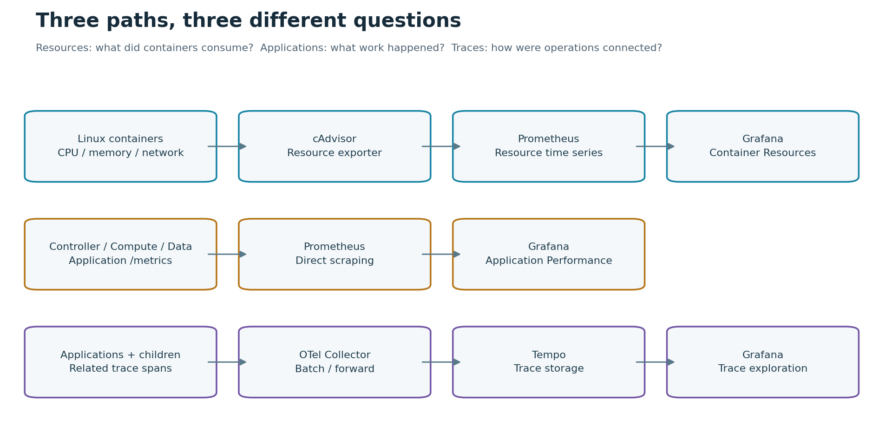
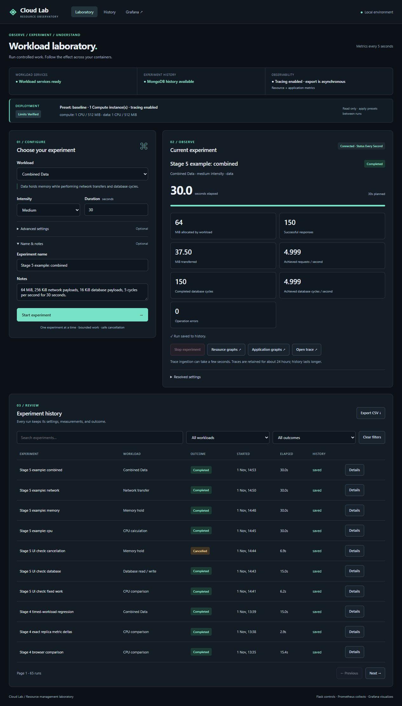

# A teammate's guide to Cloud Lab

This guide explains what the repository does, how the pieces fit together, and where to look in the code. You only need basic programming knowledge. For a live walkthrough, use the [classroom demo guide](classroom-demo.md); for commands and prerequisites, use the [setup guide](../README.md).

The original root context document is a historical planning brief. Use the current README, master plan and implementation records for the working system's settings and status.

## Start with the problem

The assignment asks for a dashboard showing actual CPU, RAM, and network usage of containers using Flask, Prometheus, and Grafana. This project adds a useful way to create that activity: an application where you configure a small experiment, run it, and observe its effects.

The measurements come from running Linux containers inside Docker Desktop. This is a local laboratory that demonstrates ideas used in cloud resource management. It does not deploy to a public cloud or measure the entire Windows laptop.

There are two places to work:

- **The Flask application** at `http://localhost:5000` controls experiments and shows exact reported operation counts and saved results.
- **Grafana** at `http://localhost:3000` displays container resources, application performance, and traces.

An experiment setting is an input. A measurement is what actually happened. For example, requesting 5 downloads per second does not guarantee that the service achieves that rate.

## What has been implemented

| Stage | What it added |
|---|---|
| 1 | Real container CPU, memory and network measurements; provisioned Grafana resource dashboard |
| 2 | Interactive controller, Data service, MongoDB history, asynchronous workloads and cancellation |
| 3 | Direct application metrics and connected OpenTelemetry traces through Collector and Tempo |
| 4 | Verified CPU/memory presets, fixed calculation work, optional second Compute instance and saved batch assignments/results |
| 5, revised | Improved dark interface and dashboard layouts, four understandable examples, this guide and a classroom walkthrough |

The [example results](experiment-results.md) are single observations. A formal repeated study, official university Word report, and PowerPoint presentation remain future work.

## Meet the services

Baseline uses seven containers without tracing and nine with tracing. A second Compute instance increases these counts to eight or ten.

| Service | Its job | What it stores |
|---|---|---|
| Controller | Serves the interface, validates settings, owns the global experiment slot and coordinates workers | Live coordination state; summaries are saved to MongoDB |
| Compute | Runs timed CPU or fixed calculation work; serves bounded payloads to Data | Recent worker results in memory |
| Data | Runs memory, network, database and Combined workloads | Recent worker results in memory |
| MongoDB | Stores experiment summaries and temporary database-workload documents | Named database volume |
| cAdvisor | Reads actual container resource measurements | Exports observations; does not replace Prometheus storage |
| Prometheus | Scrapes cAdvisor and application `/metrics` endpoints every five seconds | Time series in a named volume; seven days or 1 GiB retention |
| Grafana | Queries Prometheus and Tempo and displays the provisioned dashboards | Settings in a named volume; dashboard definitions in repository files |
| OpenTelemetry Collector | Receives, batches and forwards trace spans | Bounded transient queues |
| Tempo | Stores traces and serves trace queries to Grafana | Named trace volume, approximately 24-hour retention |
| Compute-2, optional | A separately identifiable Compute replica using the same image | Its own recent worker results |

MongoDB is the application's database. Prometheus is the measurement store. Tempo is the trace store. They have different responsibilities.

## How the application is connected



The Controller dispatches CPU work to Compute and Data work to Data. Data downloads payloads from Compute and accesses MongoDB. The Controller also uses MongoDB to save summaries. The [editable diagram source](assets/application-architecture.mmd) uses Mermaid.

Only Controller, Grafana and Prometheus have published ports, bound to local IPv4 loopback. Compute, Data and MongoDB communicate on the internal Compose network. Application containers do not receive the Docker socket.

## Three different observation paths



1. **Resource metrics:** cAdvisor observes containers; Prometheus scrapes it; Grafana draws CPU, working-set memory and interface traffic.
2. **Application metrics:** Controller, Compute and Data expose `/metrics`; Prometheus scrapes them directly. These explain requests, latency, operations, elapsed work and outcomes.
3. **Traces:** applications and workload children send spans to Collector, then Tempo. Grafana opens the connected trace.

The [editable telemetry diagram](assets/telemetry-paths.mmd) and [metric glossary](metrics.md) provide more detail. A metric answers “how much?” or “how often?” over time. A trace shows the related operations within one experiment. A saved run connects its settings, results, graph links and trace ID.

## Follow one Combined run

1. Select **Combined Data**, Medium and 30 seconds. Its resolved settings are 64 MiB of memory, 256 KiB network payloads, 16 KiB database documents and 5 cycles per second.
2. Click **Start experiment**. The browser calls `POST /api/runs`. The Controller checks deployment verification, dependency availability, input limits and the single active-run slot.
3. Start returns promptly with a run ID. The Controller sends an internal Start request to Data. Refreshing or closing the browser does not own or cancel the run.
4. Data starts a disposable child process. It allocates and touches memory, downloads payloads from Compute, and performs MongoDB write/read cycles. Temporary documents reuse at most 128 slots.
5. Approximately once a second, the child reports cumulative progress. The parent merges only new metric observations. The browser polls status once a second and shows reported operations.
6. cAdvisor independently observes the resulting resource activity. Grafana queries those measurements; graphs can lag visible application progress because rates use time windows.
7. The trace keeps Controller, Data, Compute and MongoDB client operations connected. It includes representative successful I/O cycles and every failed cycle. Metrics count all reported operations.
8. At completion, Data removes temporary documents and reaps the child. Child exit releases its memory buffer. The Controller saves the final summary and releases the global slot.
9. Open **Details** in history to review settings and the deployment at Start. Resource graphs, application graphs and the trace link use this run's time range. CSV exports preserve the settings and actual counters.



Run states are `starting`, `running`, `stopping`, `completed`, `cancelled`, `failed` and `interrupted`. Stop is idempotent. It must terminate and reap workload processes within five seconds. Cancellation/failure retains known partial results; it does not claim unreported work.

## Understand the workloads

| Choice | What runs | Where to observe it |
|---|---|---|
| CPU calculation | One calculation child alternates busy/idle intervals for the requested duration | Compute CPU cores |
| CPU comparison | A fixed number of deterministic batches, using two calculation processes total | Compute / Compute-2 CPU, batch counts and checksums |
| Memory hold | Data touches a buffer, holds it, and releases it through child exit | Data working set |
| Network transfer | Data downloads and discards Compute responses | Data receive / Compute transmit |
| Database read / write | Data performs one write and one read per cycle | Data and MongoDB resources; database operations and I/O latency |
| Combined Data | Holds memory while executing network and database cycles | Data, Compute and MongoDB; connected trace |

Timed workloads default to 30 seconds, with a 15–180 second range. Low/Medium/High resolve into bounded workload-specific settings. Memory is normally capped at 128 MiB; the 256 MiB Data deployment caps allocations at 64 MiB.

Each service has one Gunicorn application worker with eight request threads. The disposable calculation/workload children are separate processes. Gunicorn's master, container init and short health checks also exist, so a Docker process count is not the application worker count.

## Fixed work and resource comparisons

One calculation unit evaluates `sum(n*n % 104729 for n in range(3000))`. One logical batch contains 2,500 units. Medium selects 32 batches: 80,000 units and completed checksum **12,007,132,800,000**. The algorithm version is `sum-squares-v1`.

Two calculation processes total are held constant:

- One Compute container: two slots handle alternating batch lists.
- Two Compute containers: each has one slot; numbered batches alternate between instances.

Assignments are saved before dispatch. Completed batches are counted once. A failed or ambiguously acknowledged batch is not automatically retried or redistributed. A 180-second independent safety deadline bounds the action.

CPU presets change Compute's ceiling to 0.5, 1 or 2 cores. Memory presets change Data's ceiling to 256, 512 or 1,024 MiB. Replica-2 gives each Compute instance one core and 512 MiB, doubling the combined Compute allocation. This is not an equal-resource scaling comparison.

Use deployment scripts while no run is active. They validate the merged configuration, establish durable maintenance, inspect Docker limits, and compare worker cgroup readings before allowing Starts. The application only reads this configuration. See the [preset guide](presets.md) for every command and the [Stage 4 results](stage-4.md) for verified examples.

## Find your way around the code

| Location | What to read there |
|---|---|
| `compose.yaml` and `deployment/` | Service wiring, resource ceilings, profiles and named preset overrides |
| `services/controller/app.py` | Public endpoints: catalog, deployment, runs, history and CSV |
| `services/controller/coordinator.py` | Global ownership, dispatch, status transitions, persistence retries and recovery |
| `services/controller/fixed_coordination.py` | Multi-instance fixed-work assignment/results, cancellation and reconciliation |
| `services/controller/repository.py` | MongoDB summaries, history filtering and temporary-document cleanup |
| `services/controller/templates/` and `static/` | HTML layout, CSS and browser polling/rendering |
| `services/compute/app.py` and `services/data/app.py` | Small entry points using the shared worker application |
| `services/shared/model.py` | Presets, validation and public run/graph representations |
| `services/shared/worker.py`, `workload_child.py` | Timed worker supervision and actual disposable workload implementation |
| `services/shared/fixed_work.py`, `fixed_runner.py`, `fixed_child.py` | Deterministic assignment/calculation and supervised fixed-work processes |
| `services/shared/metrics.py`, `io_stats.py`, `tracing.py` | Parent registries, child latency summaries and trace propagation/export |
| `services/shared/deployment.py` | Read-only preset state and cgroups v1/v2 limit inspection |
| `monitoring/` | Prometheus scraping, Grafana provisioning/dashboard JSON, Collector and Tempo configuration |
| `scripts/` | Startup, verification, presets, demonstrations and reproducible evidence/plot generation |
| `services/tests/` | Validation, concurrency, cancellation, recovery, metrics and tracing regressions |
| `docs/` | Guides, glossary, stage records and saved evidence |
| `.runtime/` | Ignored generated deployment state, exclusive deployment lock and expected application scrape targets |

The Dockerfile selects the service through a build argument and copies the shared modules. `gunicorn_conf.py` starts supervision and tracing once in each application worker, after forking. Keep one Gunicorn application worker: coordination locks and registries are process-local.

## Operate it safely

From the repository root in PowerShell 7, with Docker Desktop's Linux engine running:

```powershell
# Build/start the known classroom configuration:
./scripts/start.ps1 -Preset baseline -Tracing
./scripts/verify.ps1
# Once images exist, the same configuration can start offline:
./scripts/start.ps1 -Preset baseline -Tracing -NoBuild
# Normal shutdown preserves named volumes:
./scripts/stop.ps1
```

Read your local `.env` to sign into Grafana. Do not put its password in a guide, screenshot, shared archive or source control. The setup guide describes first startup, logs, readiness checks, and the separate destructive reset command. Normal demonstrations do not require a reset.

Summary history, Prometheus data, Grafana state and Tempo traces use named volumes and survive normal stop/start. Trace retention is shorter than history. A saved trace ID can outlive its trace; saved JSON examples/screenshots remain available in the evidence folder.

## Small glossary

| Term | Meaning here |
|---|---|
| Container | An isolated service process environment running inside Docker Desktop's Linux engine |
| Resource ceiling / quota | The maximum CPU or memory a container is allowed to consume |
| Working set | Container memory in active use, including application and interpreter overhead |
| Scrape | Prometheus collecting one endpoint's current metric observations |
| Counter / rate | A cumulative count / its change per second over a stated time window |
| Histogram / p95 | Bucketed observations / a latency estimate below which about 95% of observations fall |
| Span / trace | One timed operation / the connected spans for an experiment |
| Replica | Another separately identified instance of the Compute service |
| Deployment preset | A saved combination of resource ceilings, enabled instances and verification expectations |
| Run | One experiment's settings, lifecycle, reported work and saved result |

## Questions your teammates may ask

**Why is CPU shown in cores?** A value of 1 means one core's worth of CPU time. A separate quota-relative panel divides usage by the container ceiling. Neither measures total laptop CPU use.

**Why is memory larger than the requested buffer?** Working set includes the parent application, child interpreter, libraries and telemetry. A memory ceiling does not allocate that entire amount automatically.

**Why do the graph and operation counter disagree?** They measure different things. cAdvisor traffic includes protocol and control traffic; workload bytes count received payload bytes. Five-second scraping and 30-second resource/two-minute application rate windows also smooth changes.

**Does collection health mean the application is healthy?** It means Prometheus can scrape the exporter. MongoDB availability, worker readiness and workload success are separate signals.

**What happens if MongoDB stops?** CPU, Memory and Network remain usable. Database/Combined become unavailable. Up to 100 pending summaries are retained in controller memory and retried; they can be lost if the controller restarts before saving.

**What happens if a worker or Controller restarts?** Remaining work is reconciled and cancelled as necessary; affected runs become interrupted. Work is never automatically replayed. An unreachable worker blocks new Starts until its state is known.

**What if tracing stops?** Workloads remain usable. Bounded exporter queues/timeouts protect execution and Stop, but spans can be lost. Health and normal polling are excluded from traces.

**Where should I start reading?** Follow a public Start endpoint into the Controller coordinator, then the worker supervisor and child implementation. Finally follow the result back through persistence and the browser. This follows the same path as the Combined walkthrough above.
